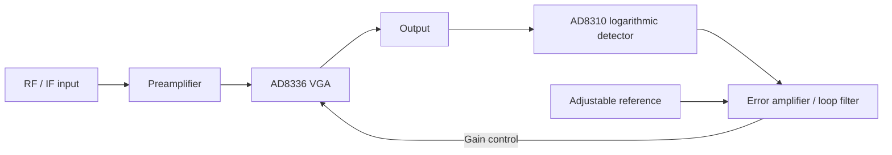

# Wideband Automatic Gain Control (AGC)

**Analog electronics · RF receiver front ends · LTspice · KiCad · PCB development**

A Bachelor's thesis engineering project investigating a closed-loop analog automatic gain control circuit for receiver applications. The objective is to regulate the output signal amplitude as the input level changes, using an adjustable output-level reference.

> **Project status:** Portfolio under preparation. Original circuit files, simulation plots, thesis documentation and hardware measurements will be added as available. No performance figures on this page are presented as experimentally verified.

## System architecture

The detector monitors output amplitude. The feedback controller compares its output with a reference and adjusts the VGA gain to reduce the error.

## Engineering objectives

| Area | Objective |
| --- | --- |
| Amplitude regulation | Maintain a selectable output level over varying input amplitudes |
| Frequency response | Evaluate operation across the intended receiver signal bandwidth |
| Control loop | Characterize settling, stability and gain-control behavior |
| Hardware | Develop a four-layer PCB with suitable grounding, power distribution and test access |
| Validation | Compare simulations with prototype measurements when available |

## Repository navigation

| Folder | Contents |
| --- | --- |
| [01_Thesis](01_Thesis/) | Thesis, presentation and references |
| [02_Theoretical_Design](02_Theoretical_Design/) | Architecture, calculations and component selection |
| [03_LTspice_Simulation](03_LTspice_Simulation/) | Editable schematics, model setup and simulation instructions |
| [04_Simulation_Results](04_Simulation_Results/) | Waveforms, test conditions and results |
| [05_KiCad_PCB](05_KiCad_PCB/) | Editable PCB project, layout and visual documentation |
| [06_Manufacturing](06_Manufacturing/) | Fabrication and assembly outputs |
| [07_Hardware_Testing](07_Hardware_Testing/) | Test plan, measurements and prototype photos |
| [08_Engineering_Log](08_Engineering_Log/) | Design decisions, debugging and lessons learned |

## Key components and tools

- AD8336 variable-gain amplifier
- AD8310 logarithmic detector
- Analog error amplifier and loop filter
- LTspice for circuit simulation
- KiCad for schematic capture and PCB layout

## Results and verification

See [simulation results](04_Simulation_Results/) and [hardware testing](07_Hardware_Testing/). Simulation data and physical measurements will be identified separately, with test conditions and source files.

## Thesis publication

The final approved thesis or its Theseus publication link will be added in [01_Thesis](01_Thesis/).

## Usage and attribution

No open-source license has been selected. Third-party simulation models, datasheets and university materials remain subject to their respective terms. Upload only material that is authorized for publication.

See [UPLOAD_GUIDE.md](UPLOAD_GUIDE.md) for file placement instructions.
